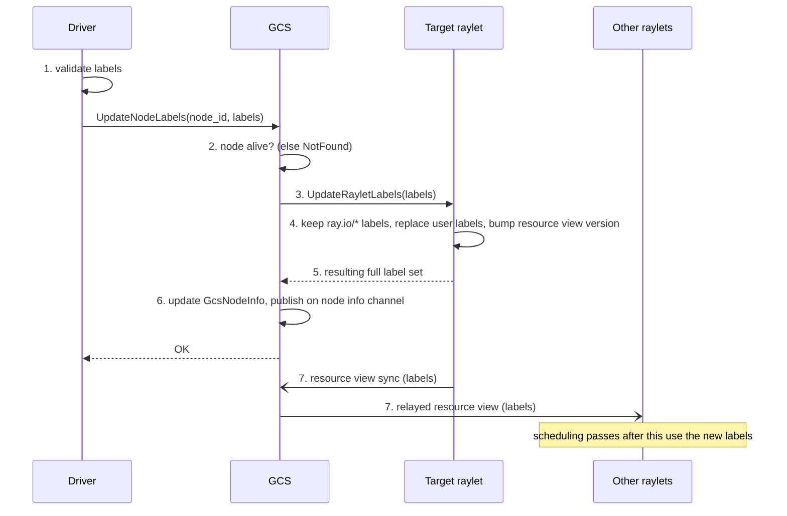

# REP: Runtime Node Label Updates

## Summary
### General Motivation
Node labels are set once, when a node starts (`ray start --labels`, `--labels-file`, or the KubeRay `rayStartParams`). The [label-based scheduling REP](https://github.com/ray-project/enhancements/blob/main/reps/2025-03-18-label-based-scheduling.md) made labels the main way to steer tasks and actors with `label_selector` and `fallback_strategy`. It treats node labels as fixed for the node's lifetime. Changing a label today means restarting the raylet on that node.

That is a problem on long-lived clusters where labels encode policy rather than hardware. One example is a cluster that serves several Ray Serve applications as tenants:

- Nodes are labeled `service_type: service-a` or `service_type: service-b`. Each deployment's `label_selector` pins its replicas to its tenant's nodes.
- Moving capacity from one tenant to another (relabeling a `service-a` node as `service-b`) is a policy change. Today it requires restarting the raylet on that node, which kills every worker on it.
- Renaming a label key or value means restarting every node that carries it, which in practice means rolling the whole cluster.
- Adding a new label to nodes that are already running is not possible.

Pre-declaring every label a node might ever need does not work when the policy set keeps changing.

This REP proposes an API to replace a running node's user-defined labels, so that scheduling decisions made after the update use the new labels. It does not change how labels are matched, and it does not move work that is already placed.

Issue: [ray-project/ray#45375](https://github.com/ray-project/ray/issues/45375). Prototype: [ray-project/ray#64986](https://github.com/ray-project/ray/pull/64986).

### Should this change be within `ray` or outside?
Within `ray`. Node labels live in the raylet's local resource manager and in GCS node info, and both the scheduler and the autoscaler read them there. There is no way to change them from outside Ray short of restarting the raylet.

## Stewardship
### Required Reviewers
@MengjinYan @ryanaoleary @andrewsykim (contributors to label-based scheduling)

### Shepherd of the Proposal (should be a senior committer)
TBD (a senior committer familiar with label-based scheduling)

## Design and Architecture
### API
```python
ray.experimental.update_node_labels(
    node_id: str,                  # hex node ID, as in ray.nodes()[i]["NodeID"]
    labels: Dict[str, str],        # the full set of user-defined labels
    timeout: Optional[float] = None,
) -> None
```

`labels` replaces the node's user-defined labels. A key left out is removed, and an empty mapping clears them all. Labels with the `ray.io/` prefix (`ray.io/node-id`, `ray.io/accelerator-type`) belong to Ray: the API can't set them and never removes them.

Keys and values go through the same validation as `ray start --labels`, so invalid input raises `ValueError` before any RPC is sent. Updating a node that isn't alive returns `NotFound`. If the raylet fails, the caller gets that error and the GCS record stays as it was.

The API lives under `ray.experimental` for the first release.

### Flow


1. The driver validates the labels and calls the new GCS RPC `UpdateNodeLabels(node_id, labels)`.
2. GCS looks up the node. If it is not alive, it returns `NotFound`.
3. GCS forwards the labels to that node's raylet with the new RPC `UpdateRayletLabels(labels)`.
4. The raylet's `LocalResourceManager` builds the new label set: the existing `ray.io/` labels plus the requested user labels. If the set changed, it replaces the node's labels and bumps the resource view version.
5. The raylet returns the resulting full label set to GCS.
6. GCS stores that set in its `GcsNodeInfo` and publishes it on the node info channel, so `ray.nodes()` and node info subscribers see the change.
7. On the next resource view sync, the new labels reach GCS, which relays them to every other raylet. Label selector matching for tasks and actors scheduled after that uses them.

The raylet is the source of truth for its node's labels, as it already is for resources. GCS only caches what the raylet reports.

### Consistency
When the call returns, the target raylet and GCS have the new labels. Other raylets get them on the next resource view sync, so a task scheduled by another raylet in between can still be matched against the old labels.

Two updates to the same node apply in the order the raylet receives them, and the last one wins. GCS also takes labels from every resource view sync, so its record converges to the raylet's even if raylet replies arrive out of order. The same sync covers a GCS restart: the node re-registers with its startup labels, `ray.nodes()` shows those for a moment, and the next sync brings back the updated set.

Updated labels are not persisted. A restarted raylet comes back with its startup labels. Persistence is listed under follow-on work.

### Effect on scheduling
Labels are checked when work is placed. An update affects placement decisions made after it reaches the scheduler and leaves work that is already placed alone.

- Running tasks and actors stay where they are, even if they no longer match their `label_selector`. Nothing is moved or preempted.
- Leases that a raylet holds but hasn't assigned to a node yet are matched against the new labels. A raylet re-runs this scheduling pass whenever it receives a resource view update and on a timer, and the pass also retries leases it had marked infeasible. So work that was pending because no node matched its selector can start right after a relabel. In the tenant example, this should let Serve replicas waiting for a `service-b` node start. The end-to-end test in the test plan checks it.
- Leases already assigned to a node and waiting for a worker there keep that node.
- Placement group bundles that are already reserved stay where they are. New bundles and new placement groups use the new labels. Whether pending actors and placement groups scheduled by GCS are retried on a label change needs to be confirmed; see the test plan.
- `fallback_strategy` is unchanged: each option is matched against the labels known when the scheduling pass runs.

### Autoscaler
Autoscaler V2 reads node labels from GCS node info, which this change keeps current, so it sees updated labels on existing nodes. It still launches new nodes with the labels from their node type configuration. Scaling up can't satisfy a demand for labels that only a runtime update would add, because the autoscaler has no way to know a node will get them later. The autoscaler already behaves this way for labels that no node type declares. The label-based scheduling guide should note that this also applies to runtime updates.

[enhancements#68](https://github.com/ray-project/enhancements/pull/68) chooses node types for label demands at scale-up, so it decides the labels of nodes being created. This REP changes the labels of nodes that already exist, so the two don't overlap.

### Naming
Autoscaler state has an older, deprecated "dynamic labels" field for placement group labels (`NodeState.dynamic_labels`). This REP is unrelated to it, so the feature is called "runtime node label updates" to avoid confusion.

### Security
The call needs the same access as any other GCS RPC. When token authentication is enabled, the RPC is authenticated like the rest of the GCS service. Changing labels can move where future work is scheduled, so it should not be exposed to clients that can't already submit work to the cluster.

### Alternatives considered
- Restart the raylet. This is what users do today, and it kills every worker on the node.
- Encode policy as custom resources. Custom resources can't be updated at runtime either, and they have no equivalent of the `in()` and `!` operators in label selectors.
- Merge or patch semantics (set some keys, delete others). More flexible, but every caller then has to reason about keys it didn't mention. Replacing the whole set makes the call idempotent, and a patch API can be built on top of it later.
- Read labels from Kubernetes pod labels. That only helps KubeRay users, and it ties Ray scheduling to pod metadata that people change for unrelated reasons.

### Edge cases
- If the node dies during the update, GCS returns the raylet RPC error. The node is gone, so there is nothing to reconcile.
- An update that leaves the label set unchanged doesn't bump the resource view.
- When a selector stops matching any node, pending work stays pending, as it does for any unmatched selector today. [ray-project/ray#65166](https://github.com/ray-project/ray/pull/65166) proposes naming the selector in Ray Serve's slow-scheduling warning.

## Compatibility, Deprecation, and Migration Plan
The change is additive: a new experimental Python API and two new RPCs. Existing label behavior is unchanged when the API isn't called. Nothing is deprecated.

Ray requires the driver and every node to run the same version, so there is no mixed-version case to handle.

## Test Plan and Acceptance Criteria
The prototype in [ray-project/ray#64986](https://github.com/ray-project/ray/pull/64986) includes:
- Raylet: a `LocalResourceManager` unit test for replace semantics with reserved labels kept.
- GCS: `GcsNodeManager` tests for forwarding to the raylet and refreshing the cached labels, `NotFound` for an unknown node, and converging to the labels a raylet reports in its resource view. The Active-Passive leader gating test covers the new RPC.
- Python: `test_node_labels.py` checks that updated labels show up in `ray.nodes()` and change where newly submitted work runs, that reserved and invalid keys are rejected, that an unknown node is an error, and that an empty mapping clears user labels.

Before graduating from `ray.experimental`:
- An end-to-end test with Ray Serve: after a node is relabeled, new replicas of a deployment whose `label_selector` matches the new label are placed on it, and running replicas stay where they are.
- A test that a raylet restart reverts to startup labels and a GCS restart converges back to the updated labels.
- A test that an update with an unchanged label set doesn't trigger a resource view broadcast.
- A test that a task pending on an unmatched `label_selector` starts after a node is relabeled to match it, and the same for a pending actor and placement group scheduled by GCS.
- Documentation in the label-based scheduling guide covering the semantics above, including that updates are not persisted and only affect future placement.

## (Optional) Follow-on Work
- Keep updated labels across raylet restarts, for example by storing them in GCS and applying them when the node re-registers.
- A CLI command such as `ray label set <node> key=value`, and a label editor on the dashboard's cluster page.
- A patch API that sets or deletes individual keys on top of the replace call.
- Syncing updated labels back to the KubeRay pod or `RayCluster` status, so the Kubernetes view matches Ray's.
